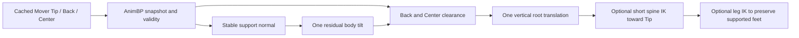

# Prone Control Rig: surface alignment and ground contact

For GASP_MM_Test, Unreal Engine 5.8.3. Written 2026-10-12.

## Recommended approach

Reuse Mover's cached Tip, Back, and Center floor samples. Apply **one body tilt and one vertical root offset** to the incoming prone animation. Add **one short spine FABRIK solve** only if the chest needs to follow ground that differs from the pelvis. Add two analytic leg IK solves only where preserving feet during a body lift is visually necessary.

This is the recommended low-cost starting architecture, not a measured fastest implementation. It requires **zero additional collision queries in Control Rig**. A whole-body iterative solver is unnecessary for basic tilt and snapping; use FBIK if the design later needs several interacting hand, foot, pelvis, and chest constraints.

Control Rig changes the visual skeleton. Mover remains responsible for physical grounding, collision shape, movement, and authoritative actor position. Moving the root bone does not move the collision capsule. If the capsule itself is unsupported or penetrating, fix the movement layer rather than hiding it with a large visual offset.



## 1. Inputs and ownership

Read `Get Prone Floor Data` from `CharacterMoverComponent` once in the character/AnimBP update and pass a coherent snapshot into the rig. Cache the component reference. Avoid repeatedly traversing the character or evaluating a pure getter separately for each pin.

| Input | Use |
|---|---|
| Tip Location / Normal / Does Hit? | Front support, chest target, body-normal selection. |
| Back Location / Normal / Does Hit? | Rear support, pelvis placement, body-normal selection. |
| Center Location / Normal / Does Hit? | Belly clearance and fallback when an end loses support. |
| Grounded, prone blend, elapsed evaluation time | Gate and blend the correction. |
| Mesh world transform, Mover up direction | Convert data and define vertical correction. |

Locations and normals are **world-space**. A false `Does Hit?` means its location is a fallback value, not an impact point. Never feed that position into the support calculation. Center is independently sampled; it is not the midpoint of Tip and Back. Native `Mover Floor Data` and project `S_FloorData` are different struct types: split/break the native outputs or convert explicitly. See [Native prone floor data](ProneFloorData.md).

The documented native implementation already samples all three probes once per grounded prone simulation substep. The Blueprint getter adds no traces. Simulated proxies consume serialized samples; the rig should not add local floor traces to replace them. Move contact snapshots across the game-thread/animation boundary using the project's supported AnimBP input path; keep worker-thread rig evaluation free of actor/world queries.

Store smoothing state **per rig instance**. Keep collision-probe origins tied to movement, not to bones already corrected by the rig; otherwise visual correction changes its own next-frame input and creates feedback.

## 2. Rotation: build a stable surface frame

Start with the same normal-selection policy as the native prone capsule:

1. Both end hits: `N = Normalize(TipNormal + BackNormal)`.
2. Only Tip: use TipNormal.
3. Only Back: use BackNormal.
4. Neither end, Center valid: use CenterNormal.
5. No valid support: use the short hold/release policy in section 5.

Validate lengths and require normals to point sufficiently along Mover's up direction. Reject degenerate sums instead of normalizing zero. Center still participates in height safety even when it is not selected for rotation. Use a stable selection policy; do not switch every frame to whichever sample happens to be slightly higher.

### Preserve heading and calibrate the skeleton axes

Let `F` be the character's intended heading and `N` the accepted surface normal. Build an orthonormal frame:

```text
Forward = Normalize(F - N * Dot(F, N))
Right   = Normalize(Cross(N, Forward))
Forward = Normalize(Cross(Right, N))
```

If projected Forward is nearly zero, retain a valid previous frame or fall back to the neutral frame. Map this frame to the body's **calibrated prone axes**. Bone local X/Y/Z and the mesh's facing axis are not interchangeable; inspect the actual skeleton and incoming prone pose. Do not assume a root or spine bone's local Z is the body's support normal.

Three Tip/Back/Center points lie roughly along one line. Their cross product does **not** give a reliable surface plane or lateral roll. Use the supplied normals for roll. On separate stair treads, equal upward normals also do not encode the height difference between the ends. Handle that difference with contact placement and optional spine IK; an additional position-derived pitch is a separate design choice, not a reliable replacement for the normals.

### Apply only the tilt the visible body still needs

Mover can rotate the live Chaos capsule geometry while the scene root stays upright. Therefore inspect the mesh's current world frame; do not infer visual tilt from the capsule debug wireframe.

Convert the desired surface orientation to rig space and calculate a rotation delta relative to the **incoming body frame**. If that frame already matches the desired surface frame, the residual delta is identity. This prevents applying the same slope angle through both the component and the rig.

Control Rig `Global` means rig space, not world space. Use **From World Location** for points. For unit normals, use inverse mesh-world rotation and normalize; do not transform a normal as a location. Assume uniform mesh scale here; nonuniform scale requires the appropriate normal transform. Epic documents the From World conversions in its [Control Rig node reference](https://dev.epicgames.com/documentation/en-us/unreal-engine/node-reference/ControlRig).

Apply one residual delta to the root/body ancestor and propagate to children. If using an AdditiveLocal rotation unit, convert a rig-space delta into the bone frame rather than plugging it directly into a local pin. With conventional quaternion composition:

```text
LocalDelta = Inverse(CurrentBoneGlobalRotation)
             * RigSpaceDelta
             * CurrentBoneGlobalRotation
```

Confirm the node's multiplication convention with a small axis test. After editing the root, **re-read the spine's current global transform** before computing any chest residual. Otherwise Back tilt and Tip tilt can accumulate twice. Preserve the existing chest/neck/head animation behavior until live axis and gameplay checks justify changing it.

## 3. Ground snapping: solve contact clearance, not capsule radius

Choose body contact anchors on the animated pose: rear/pelvis, belly, and optionally chest. Calibrate their desired clearances on a flat prone pose. Capsule radius is not a reliable mesh-to-ground clearance; body proportions and animation offsets differ.

Perform the height calculation **after body rotation**, using the rotated but untranslated pose. Preserve each anchor's horizontal position. Do not set a bone directly to an impact point, because that also drags it toward the probe horizontally.

For a valid sample, its point `P` and unit normal `n` describe a local tangent plane. Let `Q` be the matching body anchor in world space, `U` be unit Mover up, and `c` be the desired clearance measured along the surface normal. The translation along `U` that puts this anchor at that clearance is:

```text
denominator = Dot(n, U)
delta       = (c - Dot(n, Q - P)) / denominator
```

Require a safe positive denominator, for example `> 0.2`, as well as native walkability. A zero or nearly vertical normal makes a vertical-plane intersection unstable. Associate each plane with its nearby body anchor; do not extrapolate a stair-tread plane over the whole body. Bound correction distance and reject stale or implausibly distant contacts. The formula is a local support approximation, not a guarantee against unsampled terrain.

### Cheapest rigid-body version

Calculate `deltaBack`, `deltaCenter`, and `deltaTip` for the anchors you want to protect. Choose the maximum valid required offset. The common translation then satisfies those sampled minimum clearances, but may leave one end visibly floating on a crest or stair. That is the expected limitation of treating the entire character as rigid.

### Recommended uneven-ground version

Use Back to place the pelvis and **Center as a minimum clearance constraint**, even when both ends hit:

```text
requiredBodyDelta = Max(valid Back requirement, valid Center requirement)
```

If Back is missing, use Center; if both are missing, a valid Tip can provide a conservative whole-body fallback. With the spine tier enabled, Tip normally controls the chest target separately instead of raising the entire body to meet the front plane.

Smooth an **absolute world support coordinate**, then subtract the current uncorrected root coordinate to obtain this evaluation's additive offset. Storing only a previous local offset can produce incorrect lag as the actor moves vertically.

Use asymmetric height filtering:

```text
filteredSupport = Lerp(previousSupport, desiredSupport, alphaHeight)
appliedSupport  = Max(filteredSupport, currentMinimumSupport)
```

`currentMinimumSupport` is derived from current valid Back/Center constraints. Smooth downward motion, but do not let smoothing keep the belly below newly encountered support. If the safety correction exceeds the visual offset cap, record the unresolved clearance rather than claiming penetration was prevented. Large discontinuities need movement/transition handling.

Translate the root once, converting `U * appliedDelta` into rig space as a vector. Always calculate from the current incoming pose; never add offsets to last frame's already corrected output.

## 4. Optional contact refinement

### Chest: one short spine chain

After the root correction, re-read the chest position. Use Tip's plane to calculate only the remaining chest height error, preserving horizontal position. Convert the target with From World Location.

For this project's mannequin chain, start with `spine_01 ... spine_05` FABRIK. Keep the solver weight at 1 and **blend the target offset** using the prone/contact alpha. Preserve chest rotation with `bSetEffectorTransform = false` for the relevant Control Rig FABRIK unit. Preserve segment lengths and clamp unreachable targets to the chain's reach rather than stretching the spine.

Start with a small bounded iteration count, such as 4–8, and a tolerance such as 0.5–1 cm; these are tuning suggestions, not verified rig settings. The equivalent AnimBP FABRIK documentation explicitly identifies precision and iteration count as performance controls. Control Rig unit pins must be checked on the actual unit. See [Epic's FABRIK guide](https://dev.epicgames.com/documentation/en-us/unreal-engine/fabrik-animation-blueprint-in-unreal-engine).

The shortest spine chain that gives acceptable bending is preferable to solving the full skeleton. Use residual chest error after root tilt/translation, so the spine handles uneven ground rather than repeating the body's overall slope rotation.

### Feet: two analytic leg solves when needed

A Center-driven body lift can pull the legs off their rear support. If this is visible, capture Back-supported foot targets and knee/pole references **before that lift**, then solve each leg after the body and spine correction using no-stretch two-bone IK. Derive segment lengths from the animated local pose, and clamp targets to reachable distances.

Mannequin leg primary axes differ between sides; the existing project notes identify left -X and right +X. Validate these on the actual skeleton. Back contact provides an approximation for the rear ground, not independent left/right foot support. Separate foot traces are only warranted if terrain variation under individual feet matters enough to justify their cost.

If hands, feet, chest, and pelvis must all negotiate contact together, FBIK becomes a reasonable alternative. It offers per-bone constraints and multiple effectors, but requires a broader solve and more tuning than this targeted architecture. See [Epic's Full-Body IK guide](https://dev.epicgames.com/documentation/en-us/unreal-engine/control-rig-full-body-ik-in-unreal-engine).

## 5. Smoothing, contact loss, and transitions

Use elapsed time, not a constant per-frame interpolation weight:

```text
alpha = 1 - Exp(-elapsedSeconds / timeConstant)
```

Normalize interpolated normals; use quaternion slerp for orientations. Initialize state from the first valid sample. Use the same accepted support data for orientation and placement so separate filters do not fight. Smooth vertical support, not the entire world impact location; lagging horizontal contact coordinates makes the body trail behind movement.

| Control | Starting point | Purpose |
|---|---|---|
| Rotation time constant | 0.08–0.15 s | Soften slope changes. |
| Height lowering time constant | 0.08–0.15 s | Avoid abrupt drops. |
| Contact hold | 0.05–0.10 s | Bridge a brief missing sample. |
| Contact release | 0.10–0.20 s | Fade toward the incoming pose. |
| Chest adjustment cap | Around 20 cm | Limit local torso deformation. |
| Body-height cap | Separate; project notes use 80 cm | Do not accidentally share the small chest cap. |

All numbers are starting values. An 80 cm body cap is a guardrail, not a desired snap distance. Mover already has an approximately 80 ms normal stability window; extra rig filtering adds latency, so use only as much as the visible result requires. No special branch is needed when Tip and Back normals are equal.

Keep initialized history when one contact disappears and use the valid end or Center fallback. When all contacts disappear briefly while grounded, retain the accepted normal/support for the short hold, then fade correction. A cached plane is not evidence of current support. Leave hold immediately for an airborne jump/drop; do not tether the character to old ground.

Blend correction with prone entry/exit. Reset or reinitialize history after teleports, mesh replacement, or a long evaluation gap. Use accumulated elapsed time when the rig evaluates less frequently. For moving platforms, world-space cached support must move with the platform; use component-relative cached contact data if available, or shorten the hold and consume fresh samples. The three floor outputs alone do not identify a platform.

## 6. Solve order to implement

1. Snapshot cached floor inputs and incoming animation transforms.
2. Gate on prone/grounded state; validate contacts and update hold/release state.
3. Select and filter the support normal; build a calibrated target frame.
4. Apply the residual body/root rotation once.
5. Re-read pelvis/belly anchors and compute Back/Center minimum support.
6. If preserving feet, cache the supported leg targets before the body lift.
7. Filter absolute support height, enforce current clearance, translate root once.
8. Re-read chest; optionally solve the spine toward the residual Tip target.
9. Optionally solve the two legs to their cached targets.
10. Preserve existing head/neck output and pass the pose onward.

Downstream additive animation can undo contact correction. Check the full AnimGraph order, including slots and layers, before changing the rig to compensate for an error introduced later.

## 7. Cost and scaling

| Quality tier | Additional rig traces | Bone work | Appropriate use |
|---|---|---|---|
| A: rigid alignment | 0 | One tilt + one translation | Distant actors; smooth ground. |
| B: torso contact | 0 | Tier A + short bounded spine solve | Main character crossing uneven ground. |
| C: preserve rear feet | 0 | Tier B + two analytic leg solves | Close shots with visible Center lifts. |
| Multi-contact FBIK | Depends on input coverage | Iterative multi-effector solve | Several contacts must interact. |

The native three probes still have a movement-layer cost; zero additional rig traces does not mean zero total traces. Bypassing the rig does not eliminate those native movement queries.

Cache rig element references, avoid repeated hierarchy reads, and branch around spine/leg solvers when the quality tier or prone state disables them. A weight of zero is not proof that a solver or the whole rig stopped executing. Avoid runtime debug drawing and per-frame logging outside diagnostics. Use significance/LOD to drop leg IK first, then spine IK, and reduce cosmetic update rate where acceptable. Keep movement simulation and replicated contact data independent of visual animation LOD.

Profile before moving these small vector operations into C++. First use `PerformanceService.frame_timing()` in representative PIE/standalone gameplay to identify CPU versus GPU limits; then inspect animation/Control Rig scopes in Unreal Insights. Compare A/B/C with the same camera, movement route, actor count, and evaluation rate. Measure median and p95 animation/rig time, not FPS alone, and check visible jitter at 30/60/120 FPS.

An editor-only timing sample is not a rig benchmark. This documentation session sampled timing with PIE off, so no gameplay performance improvement or per-character millisecond cost is claimed.

## 8. Verification checklist

- Flat ground: neutral calibration produces no unexplained tilt/height offset.
- Uphill/downhill and sideways slopes: heading remains stable; no doubled tilt.
- Flat-to-ramp entry: Center clears the belly even while both end samples hit.
- Crest/valley and stairs: no root/chest tug-of-war; any unreachable contact is bounded.
- One end missing, then both missing: fallback/hold/release behaves without snapping to invalid locations.
- Leaving ground: stale floor samples do not pin a falling or jumping character.
- Body lift: segment lengths stay fixed and feet remain supported where tier C is enabled.
- LOD changes and teleport: smoothing history does not cause a large catch-up correction.
- Multiplayer: peers use matching Mover revisions; proxy contact use needs gameplay verification.

Draw accepted normals, contact planes, body anchors, and final targets during testing. Inspect the **live PIE mesh**, not only a rig preview. Capture the result with `capture_image(source="game")` and judge ground clearance and neck/head behavior visually.

## Evidence and scope

The recommendation uses the project's AGENTS.md gotchas, existing [floor-data documentation](ProneFloorData.md), asset registry discovery of `/Game/Blueprints/ControlRigs/CR_Crawl` and `CR_Crawl_TwoTrace`, and the Epic references linked at the relevant steps. No rig graph audit, asset edit, gameplay pass, or tier benchmark was performed for this documentation request.

WorkflowService reported the latest native Mover build as `succeeded`, `isStale=false`, finished `2026-10-11T19:27:19.120809+00:00`, with log `Saved/VibeUE/Builds/GlobalMover/EditorBuild-20261011-222652.log`. This is existing native compilation evidence, not validation of the proposed rig design.
